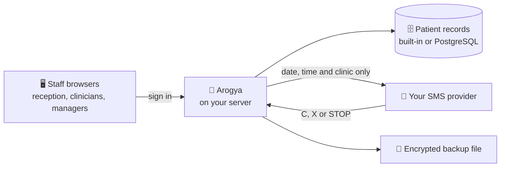

<h1 align="center">
  <br>
  <a href="https://github.com/sudharamachandranrajeev/arogya"></a>
  <br>
  Arogya
  <br>
</h1>

<h4 align="center">A health record system for small clinics: the day's patients, charts, results, referrals and reminders, on your own server.</h4>

<p align="center">
  <a href="https://github.com/sudharamachandranrajeev/arogya/releases"></a>
  
  <a href="LICENSE"></a>
  <a href="https://github.com/sudharamachandranrajeev/brahma"></a>
</p>

<p align="center">
  <a href="#-what-it-does">What it does</a> •
  <a href="#-get-started">Get started</a> •
  <a href="#-how-it-works">How it works</a> •
  <a href="#-faq-and-troubleshooting">FAQ</a> •
  <a href="#%EF%B8%8F-for-developers">For developers</a>
</p>

<p align="center">
  
</p>

Arogya (आरोग्य, "health") is an electronic health record for outpatient and community clinics.
It aims to cut the daily waste that clinicians, reception staff and managers complain about:
crowded inboxes, noisy alerts, lost referrals and empty slots. You run it on your own computer or
server, and staff use it in a web browser.

> [!WARNING]
> **Status: v0.5, pre-release.** Arogya is not certified and has not had a clinical safety review.
> Do not store real patient data until your organisation has done its own safety, security and
> governance assessment. See [SECURITY.md](SECURITY.md).

## ✨ What it does

- 📋 **The day in one list** – **Today** shows each patient's appointment, who has arrived and who
  did not attend. **Start visit** opens the chart; signing the note closes the appointment.
- 🩺 **The whole chart on one screen** – allergies, problems, medicines, vitals, results, referrals
  and notes, with small trend lines. Short phrases expand as you type, and drafts survive a reload.
- 💊 **Safer prescribing** – checks for allergies, drug interactions, doubled-up medicines and too
  high a daily dose. Only serious alerts interrupt, and overriding one needs a reason.
- 🧪 **Results that find the right person** – results are flagged against their normal range and go
  to whoever ordered them. Critical ones come first and are escalated after an hour. Clear all the
  normal ones with one click.
- 📨 **Referrals that don't get lost** – each referral is tracked until the report comes back.
  Arogya reminds the admin team to chase when a deadline passes.
- 📅 **Fewer empty slots** – double-booking is impossible. A cancelled slot offers ranked patients
  from the waiting list, and a plain no-show risk score shows its reasons.
- 💬 **Text reminders with replies** – reminders go out through your SMS provider. Patients reply
  C to confirm, X to cancel or STOP. Texts never mention the reason for the visit.
- 🔁 **Recalls and duplicates** – lists of patients overdue for routine checks (for example HbA1c in
  diabetes), and duplicate records you can merge and un-merge.
- 🔒 **Locked down** – staff roles, two-step sign-in, an idle screen lock, encrypted backups and a
  tamper-evident audit log. Administrators cannot open clinical records.

...and more: a manager's dashboard, a command palette (`Ctrl+K`), keyboard shortcuts, light and
dark themes, and a standard health-data interface ([FHIR R4](https://hl7.org/fhir/R4/), 26 record
types).

<details>
<summary><b>Everything it does today, area by area</b></summary>

| Area | Features |
|---|---|
| **Today** | Arrival (**Arrived**), did-not-attend (**DNA**) and **Start visit**, which opens the chart and closes the appointment when the note is signed. Allergy counts show before you open a record. Switch between **Show my clinic** and **Show whole clinic** |
| **Registration and identity** | Search by name, ID, phone or date of birth. Restricted-record flag. Duplicate warning at registration, a possible-duplicates worklist with a visible match score, and a **reversible merge**: old ID numbers still find the person |
| **Chart** | Allergies, problems, medications, vitals, results, referrals, appointments and notes in one call. `.dot` phrase shortcuts; drafts survive a reload; a note with unfilled `___` blanks cannot be signed. One-step vitals. Trend sparklines |
| **Prescribing** | Allergy, interaction, duplicate-therapy and maximum-daily-dose checks. Only high-severity alerts interrupt; overrides need a logged reason. Override rate is a dashboard figure |
| **Results** | Auto-flagged against each result's own reference range and critical limits. Routed to the orderer's inbox. A critical result nobody closes within an hour goes to the shared results pool |
| **Inbox** | Shared pools (results, messages, triage, scheduling) and personal queues. **Acknowledge all normal** clears normal results; abnormal results are never bulk-closed |
| **Referrals out** | Tracked through sent, acknowledged, booked and report received. Silence past an editable deadline creates one chase task; a rejection goes back to the referrer as an urgent task |
| **Waiting list** | Editable priority targets, days to breach, breach-ordered worklist |
| **Scheduling** | Clinic sessions generate slots. Race-safe booking. A cancelled or missed appointment creates a *fill this slot* task with ranked waiting-list candidates. No-show risk with its reasons |
| **Reminders and replies** | Texts a set number of hours before, through your SMS gateway (signed webhook). Date, time and clinic only. Restricted records, patients without a phone and patients who opted out are skipped. Replies: C confirms, X cancels and offers the slot, STOP ends reminders, anything else goes to reception. A desk view for reception with no clinical content |
| **Recalls** | Who is overdue, never tested or due within a month for long-term condition monitoring, and whether they are booked. Book from the list. Rules are set locally |
| **Dashboard** | Waiting list size and waits, breaches, DNA and cancellation rates, lost slots, inbox age, result turnaround, alert overrides, a *stuck work* board, and per-rule alert analytics that flag rules almost always overridden |
| **Security** | Roles enforced on the server, scrypt passwords, lockout, two-step verification (required per role if you choose), sessions end after 30 idle minutes and the screen locks after 10, break-glass access with a reason, hash-chained audit log, encrypted backups, and an access report per patient |
| **Integrity** | A daily and on-demand check of the audit chain, search index, history, references, open work, double bookings, keys and backups, with a one-click index rebuild |
| **Interoperability** | FHIR R4 REST for 26 resource types (read, vread, create, update with `If-Match`, delete, search, history, `CapabilityStatement`) and NDJSON export |

What the research found and what comes next: [docs/ROADMAP.md](docs/ROADMAP.md).

</details>

## 📸 Screenshots

<table>
  <tr>
    <td align="center"><br><sub>Today: the day in one list</sub></td>
    <td align="center"><br><sub>Chart: everything on one screen</sub></td>
    <td align="center"><br><sub>Inbox: clear normal results at once</sub></td>
  </tr>
  <tr>
    <td align="center"><br><sub>Recalls: overdue checks, booked from the list</sub></td>
    <td align="center"><br><sub>Dashboard: waits, DNAs and alerts</sub></td>
    <td align="center"><br><sub>Chart (dark)</sub></td>
  </tr>
</table>

<sub>All screenshots show the built-in demo clinic. Every patient is made up.</sub>

## 🚀 Get started

These steps run Arogya with a made-up demo clinic, so you can look around safely.

### Step 1 – Download

1. Install [Node.js](https://nodejs.org) **24 or newer** (the free program that runs Arogya). To
   check, open a terminal and type `node --version`.
2. Open the [releases page](https://github.com/sudharamachandranrajeev/arogya/releases) and, under
   the newest release, download the file for your computer:

| Your computer | File to download | Works on |
| --- | --- | --- |
| 🐧 Linux or 🍎 macOS | `arogya-v<version>.tar.gz` | Any computer that runs Node.js 24 or newer |
| 🪟 Windows | `arogya-v<version>.zip` | Windows 10 and 11 with Node.js 24 or newer |

Both files hold the same ready-to-run app. Each release also has `SHA256SUMS`, a list of
fingerprints to check the files are genuine.

### Step 2 – Unpack and start the demo

<details>
<summary><b>🐧 Linux and 🍎 macOS</b></summary>

1. Open a terminal in the folder where the download landed.
2. Unpack it and start the demo clinic:
   ```sh
   tar -xzf arogya-v*.tar.gz
   cd arogya-v*/
   AROGYA_DEMO=1 AROGYA_DATA=.demo/pg AROGYA_KEY_FILE=.demo/secret.key node server/main.ts
   ```
3. Wait for `Arogya listening on http://127.0.0.1:8080`. Leave the terminal open.

</details>

<details>
<summary><b>🪟 Windows</b></summary>

1. Right-click the `.zip` file and choose **Extract All…**.
2. Open the extracted `arogya-v…` folder, click the address bar, type `powershell` and press
   **Enter**.
3. Start the demo clinic:
   ```powershell
   $env:AROGYA_DEMO="1"; $env:AROGYA_DATA=".demo\pg"; $env:AROGYA_KEY_FILE=".demo\secret.key"
   node server\main.ts
   ```
4. Wait for `Arogya listening on http://127.0.0.1:8080`. Leave the window open.

</details>

The demo keeps its made-up patients in a separate `.demo` folder. Delete that folder to start the
demo again from fresh. To stop Arogya, press **Ctrl+C** in the terminal.

### Step 3 – First look

1. Open <http://127.0.0.1:8080> in your browser.
2. Sign in as `mehta` with the password `arogya-demo-2026`. Dr Mehta is a demo clinician.
3. On **Today**, click **Start visit** beside a patient. The chart opens with a note ready.
4. Write a line and click **Sign note**. The appointment closes on its own.
5. Press `Ctrl+K` and type a patient's name, or **Go to Inbox**.

Other demo users, all with the same password: `osei` (clinician), `nurse`, `reception`, `manager`,
`biller` and `admin`. Each sees only what their role allows.

### Step 4 (optional) – Run it for your clinic

1. Read the warning at the top of this page and [SECURITY.md](SECURITY.md).
2. Start Arogya **without** `AROGYA_DEMO`, and with `AROGYA_ADMIN_PASSWORD` set to a password of
   12 or more characters. This creates the user `admin`.
3. Sign in as `admin`, add your staff under **Admin → Users**, and set up clinic sessions.
4. Put it behind HTTPS and back up the key file.

The full guide, with PostgreSQL, Docker, reminders and backups, is in
[Running a real Arogya site](docs/running-a-site.md).

## 🧭 How it works



- **One server, many browsers.** Staff open Arogya in any modern browser. Nothing is installed on
  their computers.
- **Records stay on your server**, in a built-in database or your own PostgreSQL. Arogya never
  sends data to its makers.
- **Every look and change is logged.** Restricted records need a stated reason (break-glass), and
  the log is chained so edits show up.
- **Texts are optional** and go only through the SMS provider you choose.

> [!IMPORTANT]
> Arogya creates a key file (`.data/secret.key`) on first run. Back it up separately from the
> database. Without it, two-step sign-in cannot be checked and everyone must set it up again.

## ❓ FAQ and troubleshooting

<details>
<summary><b>Can I use it for real patients today?</b></summary>

Not yet without your own assessment. It has no certification or clinical safety case, and the
drug knowledge it ships with is illustrative only. [SECURITY.md](SECURITY.md) lists what is
missing.
</details>

<details>
<summary><b>Does it need the internet?</b></summary>

No. It runs on one laptop with the built-in database and works on a local network. Only text
reminders need a connection to your SMS provider.
</details>

<details>
<summary><b>The terminal says "No users yet"</b></summary>

You started it without the demo and without an administrator. Stop it, then start again with
`AROGYA_DEMO=1` (for the demo) or `AROGYA_ADMIN_PASSWORD` set to 12 or more characters.
</details>

<details>
<summary><b>The demo password doesn't work</b></summary>

Demo users are created only when the database is empty. If that data folder already had users,
delete the `.demo` folder and start the demo again with the command in Step 2.
</details>

<details>
<summary><b>Other computers on the network can't open it</b></summary>

By default Arogya only answers on this computer (`127.0.0.1`). For a real site, put it behind an
HTTPS web server, as the [site guide](docs/running-a-site.md) explains.
</details>

<details>
<summary><b>The screen locked while I was away</b></summary>

That is on purpose. The screen locks after 10 idle minutes, so patient data does not stay on an
unattended display. Sign in again to carry on where you were. Press `Ctrl+Shift+L` to lock it
yourself.
</details>

## 🛠️ For developers

<details>
<summary>Build from source, test and release</summary>

You need [Git](https://git-scm.com) and [Node.js](https://nodejs.org) 24 or newer.

```bash
git clone https://github.com/sudharamachandranrajeev/arogya
cd arogya
npm ci && npm run build
AROGYA_DEMO=1 npm start      # demo clinic on http://127.0.0.1:8080

npm test                     # integration tests on in-memory Postgres
npm run typecheck
npm run e2e -- http://127.0.0.1:8080                   # browser walk-through against a demo server
node test/e2e/screenshots.mjs http://127.0.0.1:8080    # re-render docs/screenshots/
npm run dev                  # API with reload
npm run dev:web              # Vite UI with a proxy to :8080
```

- Layout: `server/` (Fastify API, FHIR store, rules), `web/` (React client), `data/` (illustrative
  drug knowledge), `test/`.
- CI runs the type check, tests, build and browser walk-through on pushes and pull requests. A
  `v*` tag builds, smoke-tests and publishes the bundle (`.github/workflows/release.yml`).
- Design notes: [docs/ROADMAP.md](docs/ROADMAP.md),
  [user research](docs/research/user-pain-points.md),
  [feature inventory](docs/research/feature-inventory.md).

</details>

<details>
<summary>Credits and clean-room statement</summary>

- [Fastify](https://fastify.dev), [PGlite](https://pglite.dev) (embedded PostgreSQL),
  [node-postgres](https://node-postgres.com) and [Zod](https://zod.dev)
- [React](https://react.dev), [React Router](https://reactrouter.com) and [Vite](https://vite.dev)
- [Inter](https://rsms.me/inter/) via Fontsource, and
  [qrcode-generator](https://github.com/kazuhikoarase/qrcode-generator) for two-step set-up
- [Playwright](https://playwright.dev) for the browser walk-through
- [HL7 FHIR R4](https://hl7.org/fhir/R4/) and [LOINC](https://loinc.org)

Arogya is written from public documentation, published standards and published studies of what
users need. No code, schema, screen design or text from any other health record product was
copied, and none was reverse-engineered. Details: [docs/CLEAN_ROOM.md](docs/CLEAN_ROOM.md).

</details>

## Related

Arogya sits alongside the **Brahma** family of self-hosted apps.

| Link | What it is |
| --- | --- |
| [brahma](https://github.com/sudharamachandranrajeev/brahma) | The shared core and the all-in-one app |
| [docs/ROADMAP.md](docs/ROADMAP.md) | What is done and what comes next |
| [SECURITY.md](SECURITY.md) | Security model and how to report a vulnerability |

## License

AGPL-3.0-or-later. If you run a modified Arogya as a network service, you must offer its users the
source.

---

> GitHub [@sudharamachandranrajeev](https://github.com/sudharamachandranrajeev)
