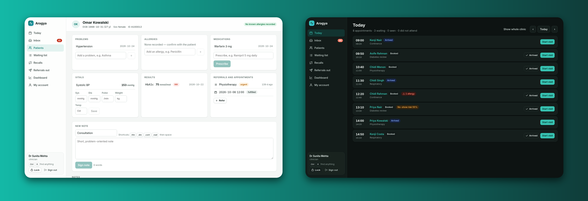
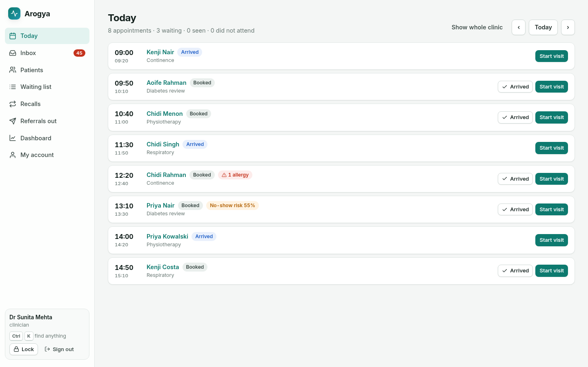
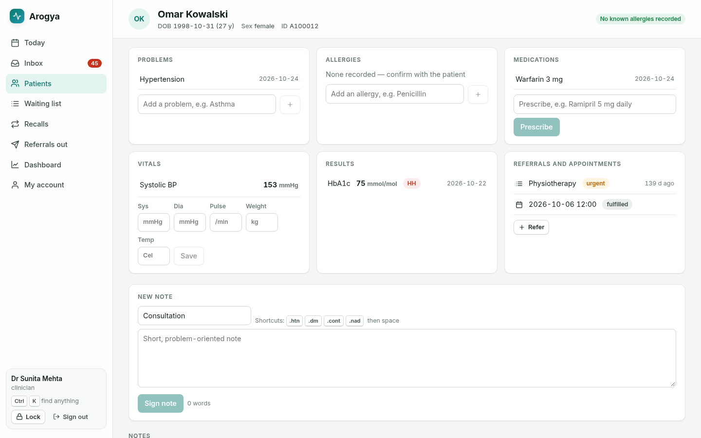
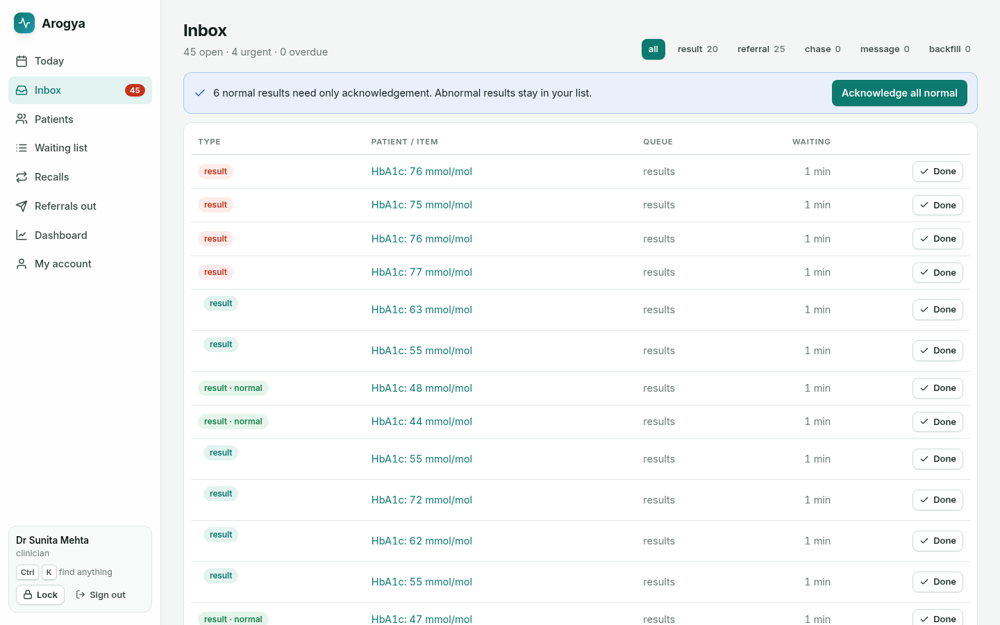
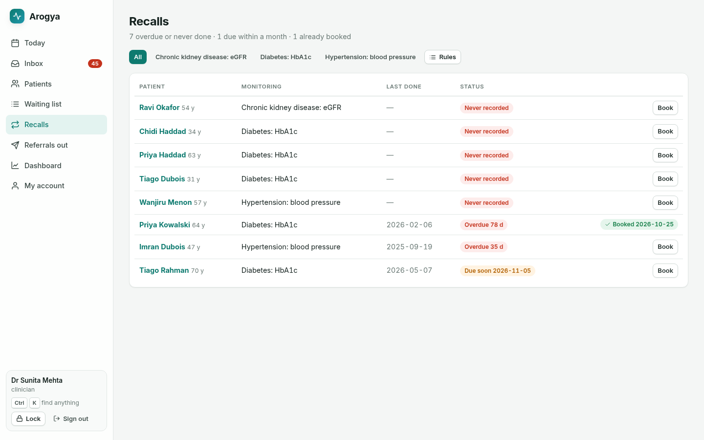
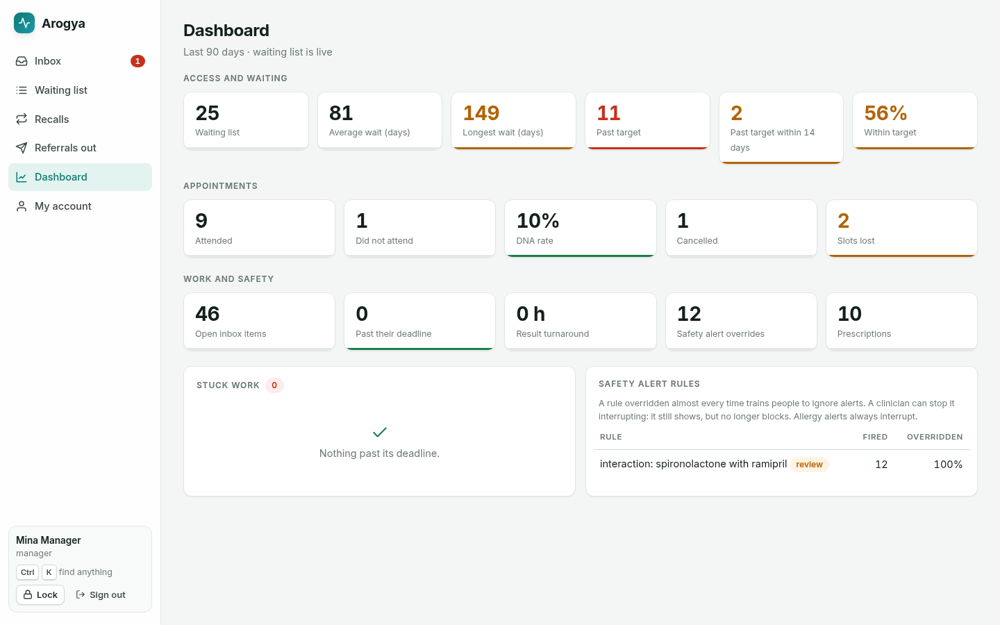
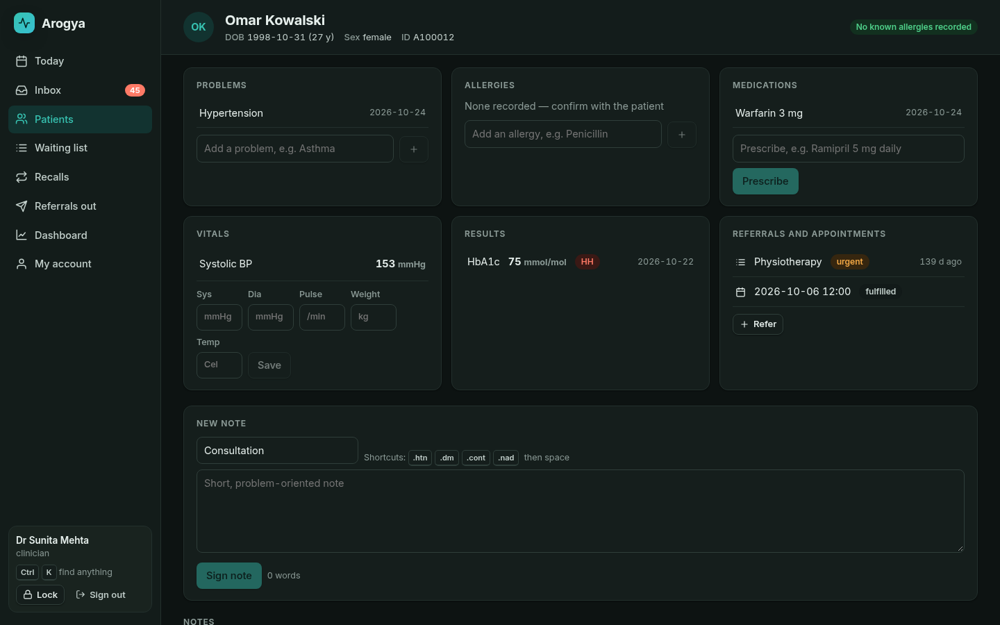

<h1 align="center">
  <br>
  <a href="https://github.com/sudharamachandranrajeev/arogya"></a>
  <br>
  Arogya
  <br>
</h1>

<h4 align="center">An open-source, FHIR-native electronic health record for outpatient and community care, built to remove the daily waste clinicians, clerks, managers and patients report.</h4>

<p align="center">
  <a href="https://github.com/sudharamachandranrajeev/arogya/releases"></a>
  <a href="LICENSE"></a>
  
  
  
  <a href="https://github.com/sudharamachandranrajeev/brahma"></a>
</p>

<p align="center">
  <a href="#key-features">Key Features</a> •
  <a href="#how-to-use">How To Use</a> •
  <a href="#download">Download</a> •
  <a href="#credits">Credits</a> •
  <a href="#related">Related</a> •
  <a href="#license">License</a>
</p>

<p align="center">
  
</p>

> **Status: v0.5, pre-release.** Arogya (आरोग्य, "health") is a working foundation for outpatient and
> community care. It is **not** certified, has not had a clinical safety review, and must not hold real
> patient data until your organisation has done its own safety, security and governance assessment.
> See [SECURITY.md](SECURITY.md).

## Key Features

* **Today** – the clinician's day in one list: arrival, did-not-attend and *Start visit*, which opens the chart and closes the appointment when the note is signed. Allergy counts show before you open a record.
* **One-call chart** – allergies, problems, medications, vitals, results, referrals, appointments and notes, with trend sparklines. Short notes with `.dot` phrase shortcuts; drafts survive a reload; a note with unfilled `___` blanks cannot be signed.
* **Safer prescribing** – allergy, interaction, duplicate-therapy and maximum-daily-dose checks. Only *high-severity* alerts interrupt, and they need a logged reason to override.
* **Results and inbox** – results are auto-flagged against their own ranges and routed to the orderer; criticals sort first and escalate to the shared pool after an hour. Acknowledge all normal results in one click.
* **Referrals out and the waiting list** – tracked from sent to report received, with automatic chasing past a deadline; priority targets, days-to-breach and a breach-ordered worklist.
* **Scheduling that fills gaps** – race-safe booking, *fill this slot* tasks with ranked waiting-list candidates, and a transparent no-show risk score.
* **Reminders and two-way replies** – SMS reminders through your gateway (signed webhook); patients reply C, X or STOP. Reception gets a desk view with no clinical content.
* **Recalls** – who is overdue, never tested or due soon for long-term condition monitoring; book straight from the list.
* **Duplicate records** – scored duplicate warnings, a possible-duplicates worklist and a **reversible merge**.
* **Dashboard** – waiting times, breaches, DNA and cancellation rates, lost slots, inbox age, result turnaround, alert overrides and a *stuck work* board, plus per-rule alert analytics.
* **Security and integrity** – roles, break-glass with a reason, TOTP two-step, idle lock, encrypted backups, a hash-chained audit log and a daily integrity check. Administrators cannot open clinical records.
* **Fast to drive** – command palette (`Ctrl+K` or `/`), `g` + letter navigation, `Ctrl+Shift+L` to lock, light and dark themes, motion that respects *reduce motion*.
* **FHIR R4 REST** – 26 resource types with read, vread, create, update (`If-Match`), delete, search, history, `CapabilityStatement` and NDJSON export.

<details>
<summary><b>Everything it does today, area by area</b></summary>

| Area | Features |
|---|---|
| **Today** | The clinician's day in one list: arrival, did-not-attend and *Start visit*, which opens the chart and closes the appointment when the note is signed. Allergy counts shown before you open a record |
| **Registration and identity** | Fuzzy patient search (name, ID, phone, date of birth), restricted-record flag. Duplicate warning at registration and a **possible-duplicates worklist** with a transparent match score (date of birth, similar names, phone, identifier, sex). **Reversible merge**: everything is re-pointed to the kept record with history preserved, old ID numbers still find the person, and a merge can be undone |
| **Chart** | One-call chart summary: allergies, problems, medications, vitals, results, referrals, appointments, notes. Short notes with `.dot` phrase shortcuts; drafts survive a reload; a note with unfilled `___` blanks cannot be signed. One-step vitals entry. Trend sparklines for results and vitals |
| **Prescribing** | Allergy, interaction, duplicate-therapy and maximum-daily-dose checks. Only *high-severity* alerts interrupt; they need a logged reason to override. Override rate is a KPI |
| **Results** | Numeric results are auto-flagged against their own reference range and critical limits. Results route to the orderer's inbox. Critical results sort first. A critical result nobody has closed within an hour is escalated to the shared results pool |
| **Inbox** | Shared work pools (results, messages, triage, scheduling) plus personal queues. **Acknowledge all normal results in one click**; abnormal results are never bulk-closed |
| **Referrals out** | Referrals to other providers are tracked through sent, acknowledged, booked and report received. Silence past a deadline (editable) creates one chase task for the admin team; recording the reply closes it. A rejection goes back to the referrer as an urgent task |
| **Appointment reminders** | Text reminders a set number of hours before, sent through your SMS gateway (signed JSON webhook, retried up to three times). Messages carry date, time and clinic only. Restricted records, patients without a phone, and patients who opted out (`urn:arogya:no-reminders` extension on Patient) are skipped, with the reason shown in the outbox |
| **Two-way replies and desk view** | With replies on, a patient's text answers the reminder: C confirms (shown on Today), X cancels and offers the slot to the waiting list, STOP ends reminders, anything else goes to reception's inbox. Reception gets a desk view of each patient (contact, appointments, referrals being chased) with no clinical content, and can switch reminders off or on. |
| **Integrity** | A daily and on-demand check of the audit chain and its head, search index, version history, references between records, open work, double bookings, keys and backups, with a one-click index rebuild. `node server/main.ts check` runs it from the command line. |
| **Recalls** | Long-term condition monitoring (for example HbA1c in diabetes, eGFR in kidney disease): who is overdue, never tested or due within a month, and whether they are already booked. Book straight from the list. The chart shows what is due while the patient is in the room. Rules and intervals are set locally |
| **Referrals and waiting list** | Priority targets (editable), days-to-breach, breach-ordered worklist |
| **Scheduling** | Clinic sessions generate slots. Booking is race-safe (two receptionists cannot take one slot). A cancelled or missed appointment creates a *fill this slot* task with ranked waiting-list candidates |
| **No-show risk** | Transparent score with the reasons shown to the scheduler |
| **Dashboard** | Waiting list size, average and longest wait, breaches, DNA and cancellation rates, lost slots, inbox age and overdue work, result turnaround, alert overrides. A *stuck work* board lists unclaimed and overdue tasks. Per-rule alert analytics flag rules that are almost always overridden; a clinician can stop a flagged rule interrupting (with a logged reason, reversible). Allergy alerts always interrupt |
| **Security** | Role-based access, scrypt passwords, lockout, session cookies (HttpOnly, SameSite=Strict), CSRF header, **hash-chained tamper-evident audit log**, **break-glass** access with a stated reason. **Two-step verification** (TOTP), which an administrator can require per role. Sessions end after 30 idle minutes; the screen locks after 10. **Encrypted backups** (AES-256-GCM). Administrators manage users and audit but **cannot open clinical records**; they can see who opened a record |
| **Ease of use** | Command palette (`Ctrl+K` or `/`), `g` then a letter to jump between pages, `Ctrl+Shift+L` to lock. Light and dark themes, motion that respects *reduce motion* |
| **Interoperability** | FHIR R4 REST for 26 resource types: read, vread (`_history/{version}`), create, update (with `If-Match`), delete, search, history, `CapabilityStatement`. NDJSON export |

The research behind these choices: [docs/research/user-pain-points.md](docs/research/user-pain-points.md) and
[docs/research/feature-inventory.md](docs/research/feature-inventory.md). The mapping and what is still missing:
[docs/ROADMAP.md](docs/ROADMAP.md).

</details>

## Screenshots

All screenshots use the built-in synthetic demo data (made-up patients only).

<table>
  <tr>
    <td align="center"><br><sub>Today: the clinician's day in one list</sub></td>
    <td align="center"><br><sub>Chart: everything on one screen</sub></td>
  </tr>
  <tr>
    <td align="center"><br><sub>Inbox: acknowledge all normal results at once</sub></td>
    <td align="center"><br><sub>Recalls: overdue monitoring, booked from the list</sub></td>
  </tr>
  <tr>
    <td align="center"><br><sub>Dashboard: waits, DNAs, work and alert analytics</sub></td>
    <td align="center"><br><sub>Chart (dark theme)</sub></td>
  </tr>
</table>

## How To Use

To clone and run Arogya you'll need [Git](https://git-scm.com) and [Node.js](https://nodejs.org) 24 or newer.
No database setup is required: without `DATABASE_URL` it uses an embedded PostgreSQL (PGlite) stored in `.data/`.

```bash
# Clone this repository
$ git clone https://github.com/sudharamachandranrajeev/arogya

# Go into the repository
$ cd arogya

# Install dependencies and build the web client
$ npm ci
$ npm run build

# Run with synthetic demo data on http://127.0.0.1:8080
$ AROGYA_DEMO=1 npm start
```

Demo users (password `arogya-demo-2026`): `mehta` and `osei` (clinicians), `nurse`, `reception`, `manager`,
`biller`, `admin`. **Never use demo mode with real data.**

### Running a real site

```bash
AROGYA_ADMIN_PASSWORD='at-least-12-characters' DATABASE_URL=postgres://… AROGYA_SECURE_COOKIES=1 npm start
node server/main.ts adduser jsmith nurse "Jo Smith" 'a-long-password'
node server/main.ts check                 # integrity report; exits 1 on a failure
node server/main.ts reset-mfa jsmith      # after restoring onto a server without the old key file
AROGYA_BACKUP_PASSPHRASE='…' node server/main.ts backup site.arogya-backup
AROGYA_BACKUP_PASSPHRASE='…' node server/main.ts restore site.arogya-backup   # into an empty database only
```

* Two-step secrets are sealed with an application key. It is created at `.data/secret.key` (mode 0600) on first
  run; set `AROGYA_KEY_FILE` or `AROGYA_KEY` (32 bytes, base64) to keep it elsewhere. Back the key up separately:
  without it, users must re-enrol two-step verification.
* Put it behind TLS. Set the server's `TZ` to the clinic's time zone: sessions are wall-clock.
* Or use Docker (PostgreSQL + Arogya): `AROGYA_ADMIN_PASSWORD=… docker compose up`.

### Develop

```bash
npm test            # integration tests on in-memory Postgres
npm run e2e -- http://127.0.0.1:8080   # browser walk-through against a fresh demo server
npm run typecheck
npm run dev         # API with reload
npm run dev:web     # Vite UI with proxy to :8080

# README screenshots (against a fresh demo server; writes docs/screenshots/)
node test/e2e/screenshots.mjs http://127.0.0.1:8080
```

Layout: `server/` (Fastify API, FHIR store, rules), `web/` (React client), `data/` (illustrative drug knowledge),
`test/`. CI runs the type check, the tests, the build and the browser walk-through on pushes to `main` and on pull requests.

## Download

Arogya is a server you run yourself. Each release on the [Releases](https://github.com/sudharamachandranrajeev/arogya/releases)
page has a ready-to-run bundle (`arogya-vX.Y.Z.tar.gz` or `.zip`, with the built web client and production
`node_modules`) and a `SHA256SUMS` file. Unpack it and start it with `node server/main.ts` as above. v0.x
releases are marked as pre-releases.

## Credits

Arogya uses the following open source packages and standards:

- [Fastify](https://fastify.dev) with [@fastify/cookie](https://github.com/fastify/fastify-cookie) and [@fastify/static](https://github.com/fastify/fastify-static)
- [PGlite](https://pglite.dev) (embedded PostgreSQL) and [node-postgres](https://node-postgres.com)
- [Zod](https://zod.dev)
- [React](https://react.dev), [React Router](https://reactrouter.com) and [Vite](https://vite.dev)
- [Inter](https://rsms.me/inter/) via Fontsource, and [qrcode-generator](https://github.com/kazuhikoarase/qrcode-generator) for two-step enrolment
- [Playwright](https://playwright.dev) (playwright-core) for the browser walk-through
- [HL7 FHIR R4](https://hl7.org/fhir/R4/) and [LOINC](https://loinc.org)

### Clean-room statement

Arogya is written from public documentation, published standards (HL7 FHIR R4, LOINC, ...) and published studies
about what users need. No source code, database schema, screen design or text from Epic, Oracle Health/Cerner,
ERPNext/Marley Health, OpenEMR, OpenMRS or any other product was copied, and no product was reverse-engineered.
Comparisons are of *capabilities*, not implementations. Details: [docs/CLEAN_ROOM.md](docs/CLEAN_ROOM.md).

## Related

* [docs/ROADMAP.md](docs/ROADMAP.md) – what is done and what comes next, mapped to the top user pain points
* [docs/research/user-pain-points.md](docs/research/user-pain-points.md) – the research the features answer
* [docs/research/feature-inventory.md](docs/research/feature-inventory.md) – the P0/P1/P2 feature inventory
* [SECURITY.md](SECURITY.md) – security model and how to report a vulnerability

## License

AGPL-3.0-or-later. If you run a modified Arogya as a network service, you must offer its users the source.

---

> GitHub [@sudharamachandranrajeev](https://github.com/sudharamachandranrajeev)
